<div align="center">

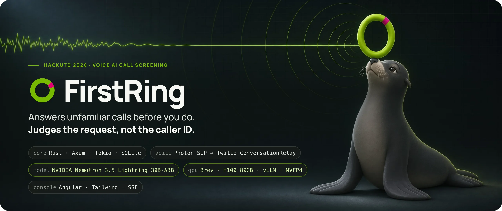

<br>

&nbsp;
<a href="#01--system-map"></a>
<a href="#01--system-map"></a>
<a href="#01--system-map"></a>
<a href="#01--system-map"></a>
<br>
&nbsp;
<a href="#03--nvidia-nemotron-on-brev"></a>
<a href="#brev-serving-stack"></a>
<a href="#brev-serving-stack"></a>
<a href="#brev-serving-stack"></a>
<a href="#brev-serving-stack"></a>
<a href="#brev-serving-stack"></a>
<br>
&nbsp;
<a href="#02--voice-pipeline"></a>
<a href="#conversationrelay-configuration"></a>
<a href="#telephony-path"></a>
<a href="#speech-to-text"></a>
<a href="#owner-voice-cloning"></a>
<a href="#text-to-speech-and-voices"></a>
<br>
&nbsp;
<a href="#07--operator-console"></a>
<a href="#07--operator-console"></a>
<a href="#07--operator-console"></a>
<a href="#07--operator-console"></a>
<a href="#07--operator-console"></a>
<a href="#testing-and-verification"></a>
<br>
&nbsp;
<a href="#hosting"></a>
<a href="#hosting"></a>
<a href="#live-mode"></a>
<a href="#further-reading"></a>

**[System map](#01--system-map) · [Voice](#02--voice-pipeline) · [Voice cloning](#owner-voice-cloning) · [Nemotron + Brev](#03--nvidia-nemotron-on-brev) · [Latency](#04--latency) · [Safety](#05--policy-and-safety) · [Firebreak](#06--neighborhood-firebreak) · [Console](#07--operator-console) · [Run it](#run-it)**

</div>

<br>

FirstRing answers unfamiliar phone calls on behalf of a household. It listens to what the caller actually wants, asks short follow-up questions, and takes a message when the request is ordinary. When the caller asks the household for something that should never be shared over the phone (a sign-in code, a gift-card redemption number, remote access to a computer), it stops, refuses politely, saves a minimized incident note, and ends the call.

The engineering idea is a strict split of authority:

- **Nemotron proposes.** NVIDIA Nemotron 3.5 Lightning reads the conversation and returns exactly one **native tool call** per step: an evidence-quoted assessment, a question, a message, a lookup.
- **Rust decides.** A single Tokio actor per call validates every proposal against the caller's literal words, the current turn and a monotonically increasing *policy epoch* before anything is spoken, saved, dialled or bridged. A late or stale model answer can never act.

> [!NOTE]
> **Fictional data.** Every person, household, contact and scenario in this repository is fictional. Live calls are real telephone calls carrying synthetic scenario data. Every number below is measured on real calls or read from the code; [Feature status](#feature-status) links each feature to its source and evidence.

<br>

## Contents

| | |
|---|---|
| **Architecture** | [System map](#01--system-map) · [Who owns what](#who-owns-what) · [Repository map](#repository-map) · [Call lifecycle](#the-call-lifecycle) |
| **Voice** | [Telephony path](#telephony-path) · [ConversationRelay config](#conversationrelay-configuration) · [STT](#speech-to-text) · [TTS and voices](#text-to-speech-and-voices) · [Owner voice cloning](#owner-voice-cloning) · [Testing with a robot caller](#testing-voice-with-a-robot-caller) |
| **NVIDIA** | [Why Nemotron](#the-model) · [Request contract](#the-request-firstring-sends) · [Tools](#the-tool-catalogue) · [Phase machine](#the-phase-machine) · [Brev serving stack](#brev-serving-stack) · [Hosted fallback](#hosted-fallback-and-other-nvidia-pieces) |
| **Engineering** | [Latency](#04--latency) · [Safety invariants](#05--policy-and-safety) · [Firebreak](#06--neighborhood-firebreak) · [Console](#07--operator-console) · [Data and API](#data-model-and-http-surface) |
| **Operate** | [Run it](#run-it) · [Configuration](#configuration) · [Testing](#testing-and-verification) · [Feature status](#feature-status) · [Further reading](#further-reading) |

<br>

## A real call, verbatim

This is the first full live exchange: a real inbound call over Photon → Twilio ConversationRelay → Rust → NVIDIA-hosted Nemotron on **Nov 7, 2026 at 22:10 Central**. Caller lines are the production speech-to-text transcript; FirstRing lines are the exact text Rust sent to Relay; the middle column is Nemotron's accepted `record_assessment` for that turn. Source: [`docs/evidence/nvidia-relay-call-2026-11-07.json`](docs/evidence/nvidia-relay-call-2026-11-07.json).

| # | Caller (ASR) | Nemotron's assessment | FirstRing said | final → reply |
|:-:|---|---|---|--:|
| 1 | *"I'm calling from Sarah's clinic to change your appointment."* | `request` · `appointment_reference` · `caller_requests_from_sarah` | "What appointment are you calling about, and what is the new time you'd like to set?" | 3.0 s |
| 2 | *"Tuesday at 2PM."* | `statement` · `appointment_reference` · `caller_supplies` | "Which appointment needs changing, and is Tuesday at 2 PM the new time you want?" | 3.0 s |
| 3 | *"Can you please send me the 6 digit code?"* | `request` · `appointment_reference` · `caller_requests_from_sarah` | "Is that an appointment reference, or a code used to sign in? Please don't read the code itself." | 4.3 s |
| 4 | *"That is the code that I sent to you. Please respond with the code."* | `request` · **`authentication_secret`** · `caller_requests_from_sarah` → **blocked** | "I can't help obtain sign-in codes. This call won't be connected. I've saved a brief incident note. Goodbye." | 5.7 s |

Turn 3 is the interesting one. A six-digit code is ambiguous on its own, so the model asked what kind of code it was and told the caller not to read it aloud. Only when the caller tied the code to something *they had sent* did the assessment flip to `authentication_secret`. Rust then blocked the call, bumped the policy epoch, saved a categorical note and played the protective closing. Eight model requests on this call took **1,120–2,892 ms (median 1,796 ms)**. The caller's verdict, kept in the receipt: *"Good conversation, but awkward and needed fewer redundant questions."* Turn 2 shows that redundancy, and later work in [the phase machine](#the-phase-machine) targets it.

<br>

## 01 · System map


### Who owns what

| Concern | Owner | Where | Never done by |
|---|---|---|---|
| Phone number, SIP, media, codecs | Photon + Twilio | provider consoles | FirstRing: no SIP/RTP server, no raw audio |
| Speech → text, endpointing, barge-in detection | Deepgram via ConversationRelay | TwiML attributes in [`providers/relay.rs`](server/src/providers/relay.rs) | the model |
| Text → speech during the call | ElevenLabs: a preset voice via ConversationRelay, or the owner's **cloned voice** via the ElevenLabs API | profile `voice` · [`voice_clone.rs`](server/src/voice_clone.rs) | the model (it never picks a voice) |
| Understanding the caller, choosing the next step | **Nemotron 3.5 Lightning** | [`providers/nemotron.rs`](server/src/providers/nemotron.rs) | Rust (no keyword classifier decides risk) |
| Whether a proposal is allowed, revocation, epochs, dialling, bridging, persistence | **Rust session actor** | [`calls/`](server/src/calls) · [`tools.rs`](server/src/tools.rs) · [`store.rs`](server/src/store.rs) | the model (it cannot dial, bridge or name a number) |
| GPU, model weights, inference server | Brev instance running vLLM | [`scripts/brev-nemotron/`](scripts/brev-nemotron) | the Rust app (reaches it only through a tunnel) |
| What the operator sees | Angular console | [`frontend/`](frontend) | the console never infers outcomes; it renders receipts |

### Repository map

```text
hackutd26/
├── server/                          Rust 2024 crate `firstring` (Axum, Tokio, sqlx, reqwest)
│   ├── src/main.rs                  boot: config → SQLite → App → Axum router
│   ├── src/http.rs                  /voice/* webhooks, Relay WebSocket, /api/*, /media/*
│   ├── src/calls/
│   │   ├── actor.rs                 one Tokio task per call; mailbox; AudioFrame gating
│   │   ├── conversation.rs          model loop (≤4 steps, 6 s), tools, speech, closings
│   │   └── state.rs                 Session: turns, epochs, offers, legs, evidence
│   ├── src/providers/
│   │   ├── nemotron.rs              chat completions, phase → tool_choice, stop tokens
│   │   ├── relay.rs                 ConversationRelay TwiML, parser, text/play/end
│   │   ├── speech.rs                ElevenLabs closings, SHA-256 cache, 5-min URLs
│   │   ├── twilio.rs                Calls + Recordings API, StatusCallback action_id
│   │   └── signature.rs             X-Twilio-Signature (HMAC-SHA1), configured URL
│   ├── src/tools.rs                 9 native tools: enums, schemas, evidence bounds
│   ├── src/voice_clone.rs           owner voice: enrollment call → ElevenLabs IVC
│   ├── src/call_recording.rs        dual-channel recordings for console playback
│   ├── src/patterns.rs              Firebreak tactic capsules (categorical, 24 h)
│   ├── src/reputation.rs            HMAC-keyed number reputation (scoped, 14 d)
│   ├── src/phone_demo.rs            operator-armed, one-use private handoff
│   ├── src/store.rs                 SQLite schema, append-only events, SSE bus
│   ├── src/bin/preflight.rs         non-dialing provider + native-tool probes
│   ├── src/bin/production_probe.rs  exact production contexts vs a real model
│   ├── src/bin/audio_fixtures.rs    synthesized caller clips for robot calls
│   └── tests/                       33 integration test files
├── frontend/                        Angular 22 + Tailwind 4 console (Zod, SSE)
├── web/                             legacy React/Vite console (/legacy-console)
├── infra/                           Terraform (S3, CloudFront, Route 53, ACM)
├── scripts/
│   ├── brev-nemotron/               serve.sh, grammar plugin, guards, receipts
│   ├── run-replay.py                inert local console with authored replay
│   └── cargo.sh                     project-local Rust toolchain wrapper
├── fixtures/                        scenarios, frozen held-out sets, results
├── docs/                            master guide, evidence receipts, runbooks
│   └── readme/                      this README's figures and their sources
└── FirstRing_Master_Guide.md        product + implementation specification
```

### The call lifecycle

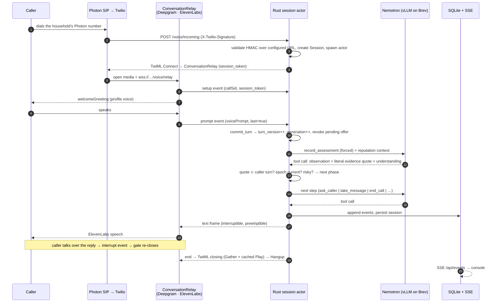

<br>

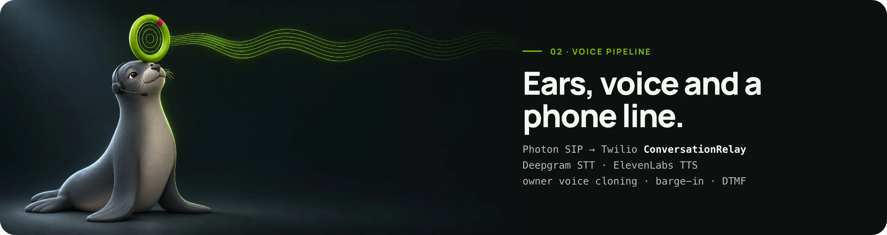

## 02 · Voice pipeline


### Telephony path

1. **Photon** provides the household's phone number: an SMS-capable US number with SIP voice. Inbound calls leave Photon over **SIP/TLS on 5061 with SRTP** and digest-authenticate to a **Twilio SIP Domain**.
2. **Twilio Programmable Voice** posts the call to `POST /voice/incoming`. Every `/voice/*` webhook is checked with `X-Twilio-Signature`: HMAC-SHA1 over the **configured** `PUBLIC_BASE_URL` plus sorted form parameters ([`signature.rs`](server/src/providers/signature.rs)). It is never derived from the `Host` header, and the implementation is pinned to Twilio's official test vectors.
3. Rust answers with TwiML that hands the media to **ConversationRelay**. Twilio keeps the live audio; during a conversation FirstRing only sees JSON text events on one WebSocket. FirstRing has no SIP/RTP stack and no codec handling. Recorded audio (the owner-voice enrollment sample and opt-in call recordings) is fetched afterwards through Twilio's REST API.

### ConversationRelay configuration

This is the exact TwiML shape built by `providers::relay::twiml` (values shown for the default profile):

```xml
<Response>
  <Connect action="https://PUBLIC_BASE_URL/voice/after-relay?relay_token=…" method="POST">
    <ConversationRelay url="wss://PUBLIC_BASE_URL/voice/relay"
        welcomeGreeting="Hi, thanks for calling. What's the call about?"
        interruptible="any" reportInputDuringAgentSpeech="any" ignoreBackchannel="true"
        dtmfDetection="true" partialPrompts="true" speechTimeout="600" language="en-US"
        hints="Sarah,sarah,FirstRing,appointment,verification code,Social Security"
        transcriptionProvider="Deepgram" speechModel="nova-3-general"
        ttsProvider="ElevenLabs" voice="cgSgspJ2msm6clMCkdW9-v4">
      <Parameter name="session_token" value="…"/>
    </ConversationRelay>
  </Connect>
</Response>
```

| Attribute | Why it is set |
|---|---|
| `interruptible="any"` + `reportInputDuringAgentSpeech="any"` | The caller can talk over FirstRing at any time. Rust receives the `interrupt` event, marks speech pending and holds every consent gate until the new words are assessed. |
| `ignoreBackchannel="true"` | "mm-hm" and "okay" do not cancel a reply. |
| `partialPrompts="true"` | Rust sees speech starting before the final transcript, so a pending private offer is put on hold immediately. |
| `speechTimeout` | Endpointing silence window. Startup-configurable: `1000` ms default, `600` ms measured faster (see [Latency](#04--latency)). |
| `dtmfDetection="true"` | Keypad digits arrive as `{"type":"dtmf"}` events. |
| `hints` | Recognition hints built from the household profile: its own name first (so "Sarah" is not heard as "sir"), then key phrases like "verification code" and "Social Security". |
| `session_token` parameter | Binds the WebSocket to the exact session created by the signed webhook. The upgrade request is itself signature-checked, the `setup` message must carry the matching token and active leg, and a duplicate setup cannot displace an attached socket. |
| `welcomeGreeting` | A neutral household greeting from the profile. FirstRing does not pretend to be the person; asked directly, it says it is an automated assistant. When the owner's cloned voice is active the attribute is omitted and Rust plays the greeting in that voice instead. |

Messages FirstRing sends back are built by Rust, never copied from raw model output:

```jsonc
{"type":"text","token":"Is that an appointment reference, or a code used to sign in?","last":true,"interruptible":true,"preemptible":true}
{"type":"play","source":"https://PUBLIC_BASE_URL/media/voice/<capability>","loop":1,"interruptible":true,"preemptible":true}   // owner voice
{"type":"end","handoffData":"{\"reason\":\"message_saved\"}"}
```

Before a frame leaves the actor, `AudioFrame::permitted_for(session)` checks that its `generation` and `policy_epoch` still match. It also checks that the inbound call is alive, no bridge has been committed and no new caller speech is pending. Model output from a turn the caller has already talked over is dropped silently.

### Speech-to-text

| | |
|---|---|
| Provider | **Deepgram**, managed by Twilio inside ConversationRelay |
| Model | `nova-3-general` by default; `flux` selectable with `RELAY_SPEECH_MODEL=flux` at startup (allow-listed, validated in `config.rs`) |
| Endpointing | `RELAY_SPEECH_TIMEOUT_MS` = `1000` (default) or `600` |
| Live configuration | `flux` with `600` ms endpointing, plus household-name `hints` |
| Fallback transport | `VOICE_TRANSPORT=gather`: TwiML `<Gather input="speech" speechModel="deepgram_nova-3">` turn-by-turn |
| What Rust receives | `prompt` (partial and `last:true`), `interrupt` (`utteranceUntilInterrupt`, `durationUntilInterruptMs`), `dtmf`, `setup`, `error` |

### Text-to-speech and voices

| Path | Engine | Voice | Notes |
|---|---|---|---|
| Conversational replies | **ElevenLabs `eleven_v4`** through Relay (`ttsProvider="ElevenLabs"`) | Per household profile: **Jessica** `cgSgspJ2msm6clMCkdW9` (default), **George** `JBFqnCBsd6RMkjVDRZzb`, **Janet** (legacy ID `21m00Tcm4TlvDq8ikWAM`) | Twilio's `-v4` voice suffix selects `eleven_v4`. The profile allow-list rejects any other ID. |
| Closing phrases | **ElevenLabs REST** `POST /v1/text-to-speech/{voice}`, `eleven_v4`, MP3 | The **same** voice as the call, taken from the profile snapshot at call start | Four fixed phrases (message saved, protective, model failure, no message). Synthesized once, stored under a SHA-256 cache key for 24 h, ≤ 512 KiB, file mode 0600. Served through a **5-minute capability URL** `/media/speech/{cap}` inside a TwiML `<Gather><Play>` closing with a short correction window. |
| **Owner voice** (opt-in) | **ElevenLabs `eleven_flash_v2_5`** via `POST /v1/text-to-speech/{voice}`, `mp3_22050_32` | The household's **cloned voice** (ElevenLabs Instant Voice Cloning) | Each reply is synthesized in the clone, kept in memory under a random 64-hex capability for 15 minutes, and sent to Relay as a `play` frame. On any synthesis error the same words go out as a preset-voice `text` frame. See [Owner voice cloning](#owner-voice-cloning). |
| Emergency fallback | Amazon Polly `Joanna-Neural` via `<Say>` | n/a | Used only when no cached closing exists and synthesis is unavailable. Every use is labeled in the receipts. |

Using pre-rendered closings in the call's own voice does two things. The goodbye plays without a synthesis wait, and the caller never hears the voice switch mid-call, which earlier builds did.

### Owner voice cloning

A household can have FirstRing answer in **the owner's own voice**. Enrollment happens over a real phone call, so there is no microphone permission prompt and the sample sounds like the phone line it will be used on. Code: [`voice_clone.rs`](server/src/voice_clone.rs); console: Settings → *Your own voice*.

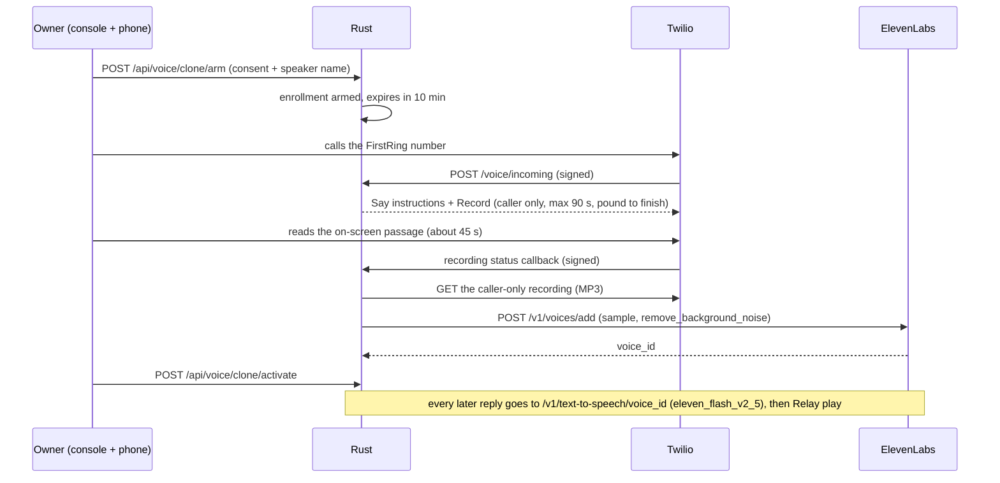

| Step | What happens | Guard |
|---|---|---|
| Arm | Operator records consent and the speaker's name. State goes to `armed`. | 10-minute expiry; only one recording in flight per household |
| Capture | The **next signed inbound call** is intercepted before screening and answered with `<Say>` instructions plus `<Record maxLength="90" timeout="6" finishOnKey="#" trim="trim-silence">`. Only the caller is recorded. | Signature-validated webhooks; one call consumes the arm |
| Check | The recording status callback starts processing. | Samples under **15 s** are rejected with a message to read the whole passage |
| Clone | The MP3 goes to **ElevenLabs Instant Voice Cloning** (`POST /v1/voices/add`, `remove_background_noise=true`). The returned `voice_id` is stored in SQLite metadata. Re-enrolling deletes the previous clone. | 60 s provider timeout; errors are kept on the enrollment and shown in the console |
| Preview | `GET /api/voice/clone/preview` lets the owner hear a sample first. | Operator-only route |
| Use | *Use my voice on calls* sets `active`. From then on the greeting and every reply are synthesized with `eleven_flash_v2_5` (stability 0.5, similarity boost 0.85) and played through Relay. Generation/epoch gating still applies, so a stale clip is dropped like a stale text frame. | Text ≤ 600 chars, 8 s synthesis timeout, automatic fallback to the preset voice |
| Delete | *Delete* calls `DELETE /v1/voices/{id}` and marks the enrollment `revoked`. | A provider 404 still counts as deleted |

A cloned voice changes how FirstRing **sounds**, never what it is **allowed** to do. The enrollment view carries `identity_verified: false`, and a familiar voice is never treated as proof of identity anywhere in the policy.

**Call recordings.** With `CALL_RECORDING=on`, each screened call starts a **dual-channel** Twilio recording 2.5 s after connecting (`RecordingChannels=dual`, signed status callback). The greeting adds *"This call is recorded."*, and the console's **Listen to the call** button plays it back.

### Testing voice with a robot caller

Text-only tests cannot show what a phone line does to speech recognition. FirstRing tests the voice path with **real telephony**:

1. [`bin/audio_fixtures.rs`](server/src/bin/audio_fixtures.rs) synthesizes authored caller lines with ElevenLabs (`eleven_multilingual_v2`, `mp3_44100_128`) in three distinct library voices. The first reviewed batch was **36/36 clips, 323–814 ms per request (median 518 ms)**, each with SHA-256 receipts.
2. A second, owned Photon line (`AUTOMATED_CALLER_FROM_E164`) places a **real call** to FirstRing's own number and plays the clips through the microphone path, one segment at a time. Twilio's own ASR transcribes FirstRing's replies on the caller side, and a recording is kept.
3. The run is graded against a rubric written **before** synthesis. A completed provider status alone does not count as a pass.

Robot calls run under a durable allowance (**26 total, 19 used**, one at a time, ≤ 90 s, own number only). Unknown outcomes are reconciled before any retry. Results, failures included, are in [`docs/evidence/automated-caller-campaign-2026-11-08.json`](docs/evidence/automated-caller-campaign-2026-11-08.json).

<br>

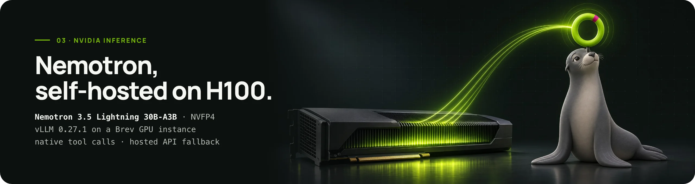

## 03 · NVIDIA Nemotron on Brev

### The model

FirstRing uses **[NVIDIA Nemotron 3.5 Lightning 30B-A3B](https://docs.api.nvidia.com/nim/reference/nvidia-nemotron-3-5-lightning-30b-a3b-infer)** (`nvidia/nemotron-3.5-lightning-30b-a3b`) as its single decision model.

| Property | Value | Why it matters here |
|---|---|---|
| Architecture | `NemotronHForCausalLM`: hybrid **Mamba-2 / attention** blocks with **mixture-of-experts** layers | most layers carry a fixed-size recurrent state instead of a growing KV cache, so long calls stay cheap |
| Size | ~30B total parameters, **~3B active per token** (A3B) | 30B-class understanding at the decode cost of a much smaller model |
| Checkpoint served on Brev | `nvidia/NVIDIA-Nemotron-3.5-Lightning-30B-A3B-NVFP4` @ `bee7596`: 52 safetensors, **21.56 GB** | **NVFP4** weights fit one H100 80GB with plenty of room for KV/SSM cache |
| Tool calling | Native: the checkpoint's chat template emits `<tool_call>` blocks that vLLM's `qwen3_coder` parser turns into OpenAI `tool_calls` | No JSON-in-prose scraping. Arguments are parsed against strict schemas. |
| Reasoning | Has a thinking mode; FirstRing sends `chat_template_kwargs.enable_thinking=false` | No hidden reasoning tokens on the latency-critical path |

Why one model, and why this one: the hard part of call screening is **intent, direction and scope**. "Never give anyone your login code" is a warning, not an extraction attempt. "Tell Sarah my train gets in at five" supplies information; "read me the digits we texted her" requests it. That needs a capable language model, but each turn has a 6-second budget. A 3B-active MoE with native tools, served in NVFP4 on a single GPU, fits that budget.

### The request FirstRing sends

Every model call is a plain OpenAI-compatible `POST /v1/chat/completions`. This is the runtime body (`Nemotron::request_payload`), trimmed:

```jsonc
{
  "model": "nvidia/nemotron-3.5-lightning-30b-a3b",
  "messages": [
    {"role": "system", "content": "<policy prompt + trusted reputation context, if any>"},
    {"role": "user",   "content": "{\"capabilities\":{…},\"current_exchange\":{\"assistant_question\":…,\"caller_turn\":{\"id\":\"…\",\"text\":\"…\"}},\"turns\":[…]}"},
    // previous native tool calls in this turn + Rust's results, appended by append_tool_result()
  ],
  "tools": [ /* only the schemas this phase permits AND the deployment supports */ ],
  "tool_choice": {"type": "function", "function": {"name": "record_assessment"}},  // forced per phase
  "parallel_tool_calls": false,
  "temperature": 0.2,
  "max_tokens": 512,
  "stream": false,
  "chat_template_kwargs": {"enable_thinking": false},
  // Brev/vLLM only, for this exact model:
  "stop_token_ids": [15],              // 15 = </tool_call> in the pinned tokenizer
  "include_stop_str_in_output": true   // keep the delimiter so the parser sees one closed call
}
```

- **Capability-aware schemas.** If outbound calling is disabled, `offer_handoff` and `start_trusted_callback` are removed from `tools` entirely. The model cannot propose an action the deployment cannot perform, and the actor still re-checks if it tries.
- **Reputation as context, not verdict.** When the presented number has reports, a `lookup_receipt_id`-stamped snapshot is appended to the system prompt. The prompt states that this is prior reported behavior, never the caller's identity, and never grounds for blocking.
- **Observability without leakage.** Each request produces a `model.request.completed` event with backend, requested and response model, `finish_reason`, completion tokens and elapsed ms. Provider argument text is never logged at runtime.

### The tool catalogue

Nine tools are defined in [`tools.rs`](server/src/tools.rs). Each has `additionalProperties: false`, closed enums and length bounds, and is parsed with serde `deny_unknown_fields`.

| Tool | The model supplies | Rust checks before acting |
|---|---|---|
| `record_assessment` | `observation {speech_act, requested_object, direction}`, literal `evidence_refs`, `understanding v1` (claimed identity, purpose, requested action, ≤2 quoted facts, ≤1 missing detail, readiness) | Every quote is a **substring of a committed caller turn**; one cites the **current** turn; generation and turn version are current; understanding invariants hold (e.g. `ready` ⇒ nothing missing) |
| `ask_caller` | one spoken question ≤ 240 chars + purpose + evidence | phase is Clarification/NextStep; no URLs; never solicits secrets |
| `take_message` | a ≤ 360-char summary + evidence | current understanding is `ready`/`caller_declined`; no speech pending; credential-like content and contact literals are minimized; **durable write succeeds before** "I've saved your message" is spoken |
| `end_call` | reason + evidence | current understanding is `no_message` |
| `lookup_tactics` | requested-action + pretext category (closed vocabularies) | read-only; **does not** clear the assessment hold |
| `lookup_trusted_contact` | role `family`/`clinic` | returns an opaque contact ID from the server directory, never a number |
| `offer_handoff` | private summary + observation + evidence | turn assessed, not blocked or ambiguous, understanding ready, intended leg live, **no pending offer** → offer bound to epoch, leg and 30 s expiry |
| `start_trusted_callback` | `contact_id` from the lookup + reason + evidence | contact enrolled; action reserved in the ledger before the provider call; suspicious caller never joins |
| `publish_tactic` | categorical tactic fields only | **post-call job only**; blocked incident on synthetic data; Rust sets provenance and expiry |

Risk is decided structurally, not by keywords. `state.rs::assess` blocks only when **`speech_act = request` ∧ `direction = caller_requests_from_sarah` ∧ `requested_object ∈ {authentication_secret, remote_access, payment_diversion}`**. Blocking increments `policy_epoch` and revokes any pending offer in the same step. `authentication_secret` covers sign-in and verification codes as well as Social Security numbers, PINs, passwords, full account or card numbers and Medicare/insurance IDs. Quotations and warnings (`speech_act ∈ {quotation, negation}`, `direction = none`) are deliberately non-risky, so "my bank warned me never to share codes" passes through as a message.

### The phase machine

Rust, not the model, decides which tool family is available next (`next_step_phase`). Forcing a single named function where possible removes a whole class of failures (calling the wrong tool, calling two tools, chatting instead of acting) and makes every step shorter.

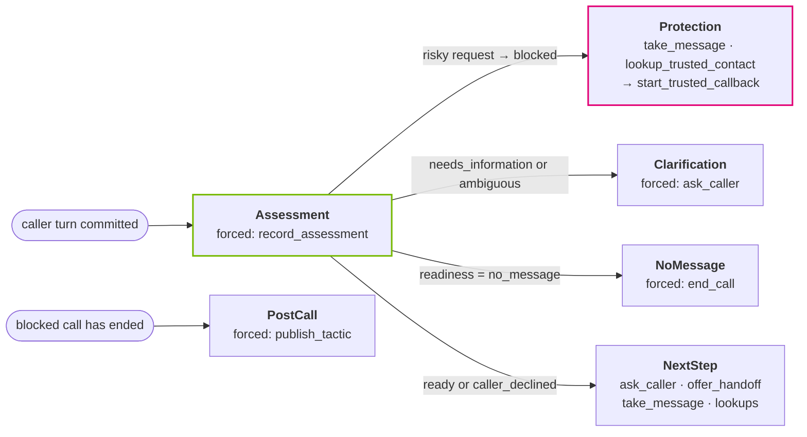

Each turn allows at most **four** native steps and **one** structural repair of a malformed assessment. Read-only lookups never clear the assessment hold.

The `PostCall` phase runs once, after a blocked live incident has ended. That is how the Firebreak learns.

<a id="brev-serving-stack"></a>

### Brev serving stack

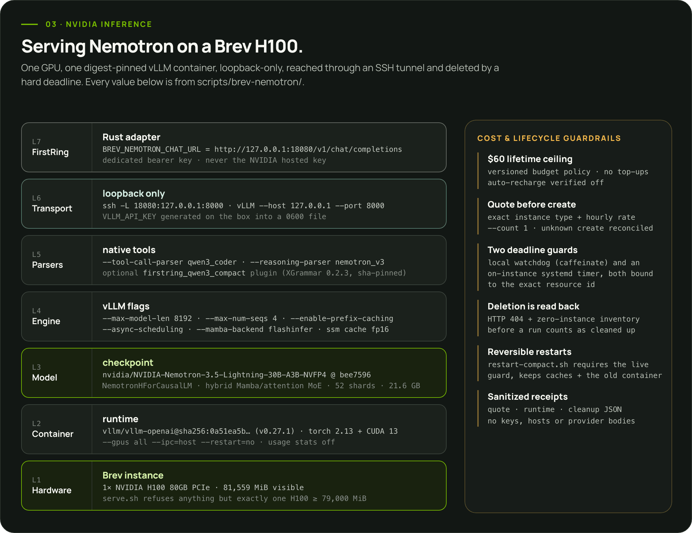

The full recipe is [`scripts/brev-nemotron/serve.sh`](scripts/brev-nemotron/serve.sh), adapted from NVIDIA's official [Nemotron 3.5 Lightning vLLM cookbook](https://github.com/NVIDIA-NeMo/Nemotron/blob/main/usage-cookbook/Nemotron-3.5-Lightning/vllm_cookbook.ipynb):

| Flag | Value | Reason |
|---|---|---|
| image | `vllm/vllm-openai@sha256:0a51ea5b…` (v0.27.1) | immutable digest, not a tag |
| `--revision` / `--tokenizer-revision` | `bee7596271d1…` | exact checkpoint; token id 15 = `</tool_call>` was verified against it |
| `--max-model-len` / `--max-num-seqs` / `--max-num-batched-tokens` | `8192` / `4` / `8192` | one household's calls, not a public endpoint; leaves memory for state cache |
| `--enable-prefix-caching` | on | the long, stable system prompt + tool schemas are reused across every turn |
| `--async-scheduling` | on | overlaps scheduling with GPU execution |
| `--mamba-backend flashinfer`, `--mamba-ssm-cache-dtype float16`, `--mamba-cache-mode align`, stochastic rounding | cookbook values | the recipe's settings for the hybrid model's SSM state cache |
| `--moe-backend` / `--linear-backend` | `humming` | kernel backends specified by the cookbook for this NVFP4 checkpoint |
| `--tool-call-parser qwen3_coder --enable-auto-tool-choice` | native tools | OpenAI-shaped `tool_calls` |
| `--reasoning-parser nemotron_v3` | | separates any reasoning text from content |
| `--host 127.0.0.1 --port 8000` | loopback only | nothing listens on a public interface; FirstRing reaches it through `ssh -L 18080` |

**Compact tool grammar.** On Nov 8 a live call (attempt 19) failed twice in one way: the model opened a valid tool call and then emitted thousands of formatting spaces until it hit the 512-token cap. Rust correctly rejected both. The fix is [`grammar/firstring_compact_tools.py`](scripts/brev-nemotron/grammar), a vLLM 0.27.1 tool-parser plugin. It subclasses the native `qwen3_coder` parser, converts its structural tag to EBNF with **XGrammar 0.2.3**, and narrows only unbounded *formatting* whitespace atoms (outside quoted strings) to `{0,2}`. Schema, enums, property order and string contents are untouched, and unexpected versions fail closed. It is enabled with `FIRSTRING_COMPACT_TOOL_GRAMMAR=1` and pinned by SHA-256. The exact attempt-19 contexts then completed in **2.975 s and 2.668 s** warm.

**Operating a GPU on a hackathon budget.** The authorization is **$60 lifetime, no top-ups, auto-recharge off**. Each run follows the same sequence: an exact quote → a fresh resource name → a local watchdog (`caffeinate`) and an on-instance systemd timer, both bound to the exact resource ID, are started → `--count 1` creation, with any ambiguous create reconciled before another request → readiness, authenticated `/v1/models`, a 401 check on a wrong key, then a native assessment → result → next-tool probe → only then is phone traffic routed → deletion is **read back** (HTTP 404 plus a zero-instance inventory). Each run gets its own spending cap and deletion deadline, enforced by both guards; quotes, runtime and cost read-backs are kept per run (the current H100 PCIe is quoted at **$3.948/h** including storage). All of this is recorded in [`docs/brev-nemotron-deployment.md`](docs/brev-nemotron-deployment.md) and `scripts/brev-nemotron/experiments/`.

### Hosted fallback and other NVIDIA pieces

| Piece | How FirstRing uses it |
|---|---|
| **NVIDIA API Catalog** (`integrate.api.nvidia.com/v1/chat/completions`) | `NEMOTRON_BACKEND=nvidia_hosted`: same model ID, same request body (minus the vLLM-only stop fields). This served the Nov 7 live call above; live calls now run on the Brev H100. Historical hosted receipts never mark a Brev backend as available. |
| **Brev** | GPU provisioning for the self-hosted inference above |
| **NVIDIA-NeMo Nemotron cookbook** | Source of the pinned vLLM serving recipe; behavior is tuned through the prompt, tool schemas, the compact grammar and Rust policy |

<br>

## 04 · Latency

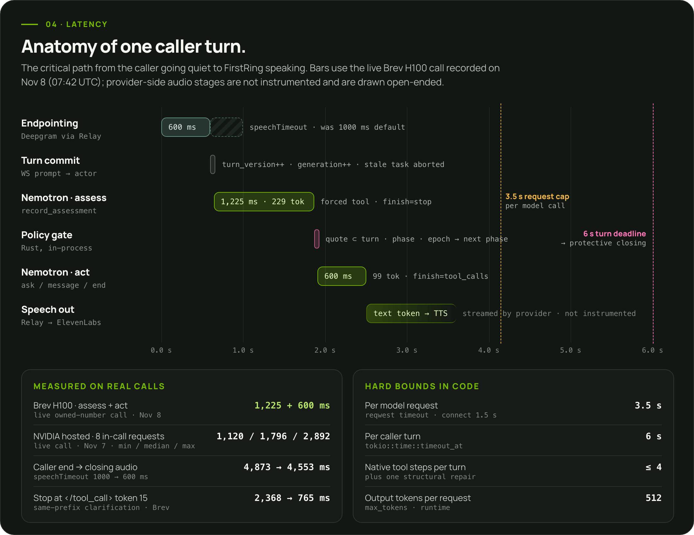

A phone conversation feels broken after roughly two seconds of silence, and every turn here needs an evidence-checked model decision before FirstRing may speak. These are the techniques that keep the gap down, with where each one lives:

| # | Technique | Where | Measured effect |
|:-:|---|---|---|
| 1 | **Self-hosted Nemotron on a dedicated H100** (NVFP4, 3B active params, ≤ 4 concurrent sequences) | `serve.sh` | Brev live call: **1,225 ms + 600 ms** for assess + act. Production probe over 9 exact production contexts: Brev **0.7–2.2 s per request (8/9 pass)** vs NVIDIA hosted **2.5–5.9 s (1/9)** |
| 2 | **Forced named tool per phase** (`tool_choice: {function: …}`): the model never deliberates over which tool to call | `request_payload` | fewer tokens; no "wrong tool" retries |
| 3 | **Phase- and capability-filtered schemas**: only permitted tools are in the prompt | `request_payload` | smaller prefill per request |
| 4 | **Stop at `</tool_call>`** (`stop_token_ids: [15]`): vLLM's `parallel_tool_calls=false` filters extra calls but does not stop decoding | `request_payload` | same-prefix clarification **2,368 → 765 ms** |
| 5 | **Thinking off** (`enable_thinking=false`) | `request_payload` | no reasoning tokens on the critical path |
| 6 | **Compact understanding schema**: ≤ 2 facts cited as `{turn_id, quote}` only; Rust derives the fact text | `tools.rs` | assessment output 229 tokens on the Brev call; prevented 512-token runaways |
| 7 | **Bounded formatting whitespace** in the tool grammar | `firstring_compact_tools.py` | attempt-19 contexts **2.975 / 2.668 s** warm instead of a truncation failure |
| 8 | **Prefix caching** with a byte-stable system prompt and schema order | `--enable-prefix-caching` | warm turns skip re-prefilling the shared prefix |
| 9 | **Shorter endpointing**: `speechTimeout` 1000 → 600 ms with Deepgram Flux | `RELAY_SPEECH_TIMEOUT_MS` | caller-end → closing audio **4,873 → 4,553 ms** (one matched pair) |
| 10 | **Pre-rendered closings** in the call's voice, cached 24 h | `providers/speech.rs` | goodbye needs no synthesis at hang-up time |
| 11 | **Interruptible, preemptible replies** and generation/epoch gating | `relay.rs` · `actor.rs` | barge-in cuts stale speech instead of queueing it |
| 12 | **Hard bounds**: 3.5 s per request (1.5 s connect), 6 s per turn, ≤ 4 native steps, 512 output tokens, one structural repair | `nemotron.rs` · `conversation.rs` | a slow model produces a safe, protective closing, never dead air |
| 13 | **Low-latency clone synthesis**: the owner voice uses `eleven_flash_v2_5` at `mp3_22050_32`, and any synthesis error falls back to the preset voice in the same turn | `voice_clone.rs` | the cloned voice never blocks a reply |

**Known slow spots.** The Relay → Gather hand-off for the closing adds roughly **1.1 s**. Quoted-report actions on Brev still sometimes exceed the 3.5 s request cap. On the hosted path, final-transcript → reply-dispatched ranged **3.0–5.7 s**. Server timestamps measure when FirstRing *sent* audio, not when the caller *heard* it; the console labels these separately and never claims audible playback it did not observe.

<br>

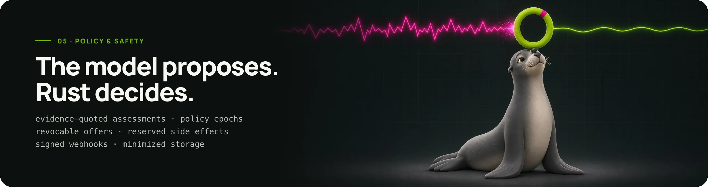

## 05 · Policy and safety

### The defining interaction: an offer that can be withdrawn

When a call is ordinary and the household member can be reached, FirstRing offers a private keypad choice: *"Press 1 to talk to them."* That offer is bound to a session, a specific outbound leg, the current **policy epoch** and a **30-second expiry**. If the caller's request changes before the key press lands, the offer dies, and an old acceptance can never bring it back.

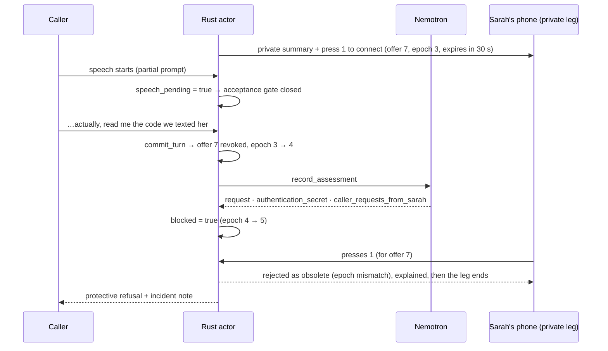

### Invariants the code enforces

- **One serialized owner.** Each inbound call has exactly one actor (`calls/actor.rs`) with a bounded mailbox. Every model result, provider callback, keypress and timer goes through it. The actor outlives the inbound hang-up until its child legs and reconciliation settle.
- **Evidence or nothing.** No assessment, message or action is accepted without a literal quote from a committed caller turn, and the assessment must cite the **current** one (`Session::evidence_valid`). Assistant words never count as evidence.
- **Read-only tools don't unlock.** `lookup_tactics` and `lookup_trusted_contact` cannot clear the per-turn assessment hold.
- **Stale work is discarded.** `generation_id` increments on speech start and turn commit. `policy_epoch` increments on revocation and blocking. Model calls, audio frames and offers carry the values they were created under and are refused if those values moved.
- **Requested ≠ ringing ≠ answered ≠ acknowledged.** Leg status is a monotonic rank (`reserved < unknown < queued < initiated < ringing < in-progress < terminal`). Duplicate and out-of-order callbacks cannot regress it, and "connected" is shown only after both intended conference participants join.
- **Reserve before you send.** Every outbound effect is written to the `actions` ledger (`UNIQUE idempotency_key`) **before** the provider request. Its `action_id` travels in the `StatusCallback` URL. An unknown create outcome is reconciled with a read, never retried blindly. No double dials.
- **The model cannot dial.** Tool arguments carry opaque contact IDs that resolve to server-enrolled numbers. URLs, phone numbers and policy changes are rejected by schema and by validation.
- **Arming is explicit.** The private handoff path needs an authenticated operator arm (`POST /api/demo/phone-demo/arm`, 60–600 s, one use) for an enrolled recipient. Page loads, refreshes and reconnects never place calls, and old inbound retries cannot capture a new arm.
- **Fixtures are inert.** Execution mode (`live`/`replay`) and data origin (`synthetic`) are independent fields. Replay can never dial or call a model.

### Request authenticity and secrets

- `X-Twilio-Signature` is validated on every `/voice/*` request against the configured public URL (official vectors in `tests/signatures.rs`). The Relay WebSocket additionally requires the per-session token.
- The operator API (`/api/*`) requires `Authorization: Bearer <DEMO_ADMIN_TOKEN>`. The one exception is the presenting machine itself: a loopback request carrying **no** forwarding headers (`cf-connecting-ip`, `cf-ray`, `x-forwarded-for`, `forwarded`, …) is trusted (`http::local_console`; `CONSOLE_LOCAL_TRUST=off` disables it). Everything that arrives through the public Cloudflare tunnel carries those headers and still needs the token. Remote consoles keep the token in memory only and stream SSE over `fetch` so the header can be sent.
- Audio URLs are **capabilities**: unguessable and short-lived (closings 5 min, owner-voice clips 15 min), never logged. Recordings are served only through operator routes.
- Provider keys live in `.env` (git-ignored). The Brev inference key is generated on the instance and never reused as the NVIDIA hosted key.

### Privacy by minimization

Saved messages are short summaries with credential-like content and contact literals stripped (ordinary times, dates and prices survive). Authentication incidents are stored categorically: *"Suspicious request blocked; independent verification recommended."* Private summaries stay on the private leg. Shared community data is categorical only (next section).

<br>

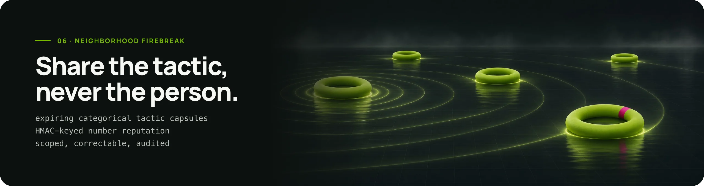

## 06 · Neighborhood Firebreak

Scammers reuse scripts, not phone numbers. When one household's call is blocked, FirstRing shares **the tactic**, never the people involved.

### Tactic capsules

After a blocked synthetic incident ends, a post-call Nemotron job proposes `publish_tactic`. Rust ([`patterns.rs`](server/src/patterns.rs)) accepts only closed categories and writes a versioned, **24-hour** capsule:

```json
{
  "id": "…", "version": 7, "schema_version": 1,
  "tactic": "authentication_code_extraction",
  "requested_action": "relay_sign_in_text_digits",
  "pretext_category": "clinic_appointment",
  "pressure_category": "urgency",
  "recommended_action": "independent_contact",
  "provenance": "designated_synthetic_test", "ttl_hours": 24, "expires_at": "…"
}
```

It contains no names, numbers, quotes, transcripts or recordings. The vocabularies are fixed lists in `tools.rs` (7 requested actions × 8 pretexts). Each subscribing household records the **version it actually applied** (`household_tactic_versions`), and the console shows that receipt, not an assumption. On a later call, `lookup_tactics` lets Nemotron match the *same tactic from a different number*.

### Presented-number reputation

[`reputation.rs`](server/src/reputation.rs) keeps scoped history for the caller ID a call *presented*. It is never treated as identity, because caller ID can be spoofed.

- **Keyed, not stored.** `number_key = HMAC-SHA256(REPUTATION_HMAC_KEY, "firstring:number-reputation:v1\0" ‖ scope ‖ "\0" ‖ E.164)`. Only the last two digits are kept for display. A fingerprint of the key is stored on first use, and a different key is refused rather than silently splitting history and hiding corrections.
- **Scoped and expiring.** `demo` and `production` scopes never mix. Reports expire after **14 days**. Levels are `none → reported → corroborated (≥2) → warning (≥3)` corroborating households.
- **Correctable and audited.** Corrections freeze escalation while under review. Every change is versioned in `reputation_audit`, and every model-context read produces a `reputation_lookups` receipt.
- **Context, not a verdict.** A reputation snapshot never blocks a call by itself. The current caller's words still decide.

<br>

## 07 · Operator console

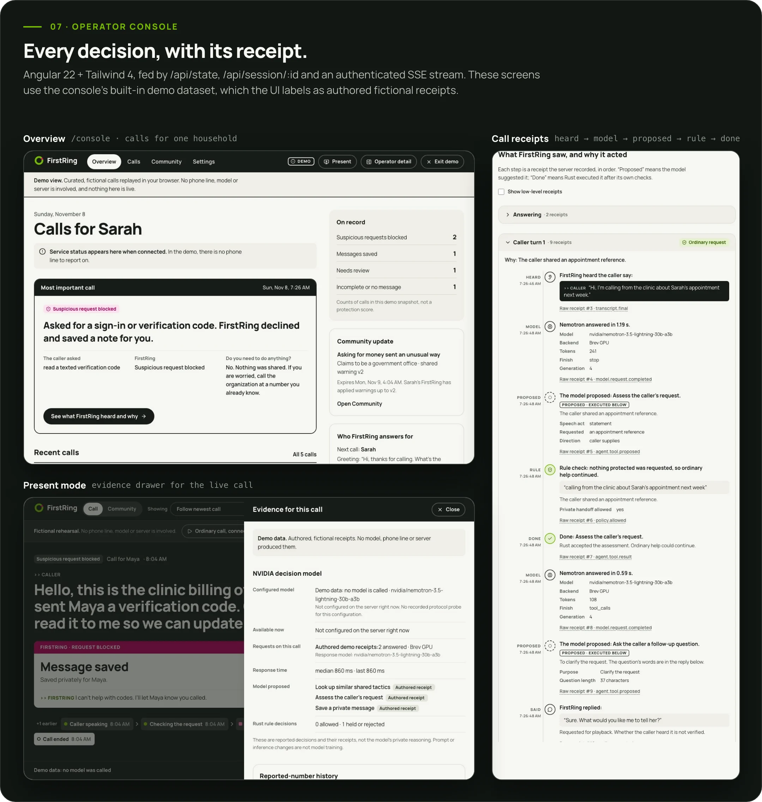

The Angular 22 + Tailwind 4 console ([`frontend/`](frontend)) is built for two audiences: the family member who wants to know *what happened and why*, and the operator who wants every receipt. Each step of a call renders as **heard → model → proposed → rule → done**. Model requests show backend, tokens, `finish_reason` and latency. Proposals stay visibly separate from executed actions. All server payloads are validated with **Zod** before rendering; the event stream is SSE with `Last-Event-ID` resume; Playwright covers desktop and mobile layouts. Settings hold the household profile (name, greeting, preset voice, timezone), the **owner voice** flow (consent → enrollment call → preview → *Use my voice on calls* → delete) and the **ring-my-phone-first** arm. Each call page can play its dual-channel recording. Rust serves the production build at `/` and `/console`, and the earlier React console remains at `/legacy-console`.

<br>

## Data model and HTTP surface

<details>
<summary><b>SQLite tables</b> (one file, created on boot by <code>store.rs</code> and <code>reputation.rs</code>)</summary>

| Table | Holds |
|---|---|
| `sessions` | the serialized `Session` aggregate per inbound call (`inbound_sid` unique) |
| `actions` | the side-effect ledger: `idempotency_key UNIQUE`, kind, mode, provider outcome |
| `events` | append-only, sequenced event log (the source for SSE and the console) |
| `metadata` | durable flags and grants (call allowances, key fingerprints, arm state) |
| `tactics` | Firebreak capsules with version and expiry |
| `household_tactic_versions` | the capsule version each household has applied |
| `reputation_identities` | session → HMAC number key (scope, mode) |
| `number_reputation` | current snapshot per number key and scope |
| `reputation_reports` | individual reports with 14-day expiry and retraction flag |
| `reputation_audit` | versioned history of every snapshot change |
| `reputation_lookups` | receipts for every reputation read used as model context |

</details>

<details>
<summary><b>HTTP routes</b> (<code>server/src/http.rs</code>; <i>operator</i> = bearer token, or trusted loopback on the presenting machine)</summary>

| Route | Auth | Purpose |
|---|---|---|
| `POST /voice/incoming` | Twilio signature | new inbound call → session + TwiML |
| `GET /voice/relay` | session token | ConversationRelay WebSocket |
| `POST /voice/after-relay` · `/voice/closing` · `/voice/turn` | Twilio signature | Relay hand-back, closing correction window, Gather fallback turns |
| `POST /voice/status` · `/voice/conference-status` | Twilio signature | leg and conference callbacks (carry `action_id`) |
| `POST /voice/whisper/{id}` · `/voice/choice/{id}` · `/voice/alert/{id}` · `/voice/ack/{id}` | Twilio signature | private-leg summary, keypad choice, contact alerts, acknowledgements |
| `POST /voice/clone-recorded` · `/voice/clone-recording` · `/voice/recording-status` | Twilio signature | owner-voice enrollment and call-recording callbacks |
| `GET /api/state` · `/api/session/{id}` · `/api/profile/…` · `/api/reputation` | operator | console state and receipts |
| `GET /api/events` | operator | SSE event stream |
| `GET /api/voice/clone` · `POST …/arm` · `…/activate` · `…/deactivate` · `…/delete` · `GET …/preview` | operator | owner-voice lifecycle |
| `GET /api/session/{id}/recording` · `…/recording/info` | operator | dual-channel recording playback |
| `POST /api/demo/phone-demo/arm` · `/disarm` | operator | one-use, time-boxed private handoff arm |
| `POST /api/demo/replay` · `/household` · `/end-call` · `/reset` | operator | operator controls (replay only runs in replay mode) |
| `GET /media/speech/{capability}` · `/media/voice/{capability}` | capability | cached closings (5 min) · owner-voice clips (15 min) |
| `GET /health/live` · `/health/ready` | none | liveness, readiness |

</details>

<br>

## Run it

### Local replay: no phone, no model, no keys

```sh
npm --prefix frontend ci && npm --prefix frontend run build   # Angular console → frontend/dist/firstring-web/browser
bash scripts/cargo.sh build --workspace                        # Rust 1.99.1 (project-local toolchain if cargo is absent)
python3 scripts/run-replay.py                                  # replay mode, all calling flags false, separate DB
```

Open **http://127.0.0.1:8080** and paste the token from `.tools/replay-admin-token`. Replay mode uses authored events. It cannot dial or call a model, and the UI labels it as replay.

### Live mode

1. `cp .env.example .env` and fill in the provider values (see [`docs/environment-setup.md`](docs/environment-setup.md)). Never paste secrets anywhere else. Expose port 8080 over HTTPS (we use a `cloudflared` tunnel) and set `PUBLIC_BASE_URL` to that origin.
2. Point the Twilio SIP Domain voice URL at `https://PUBLIC_BASE_URL/voice/incoming` and the status callback at `/voice/status`.
3. Choose a model backend. `NEMOTRON_BACKEND=nvidia_hosted` needs `NVIDIA_API_KEY`. `brev_hosted` needs a running instance from `serve.sh` and `ssh -L 18080:127.0.0.1:8000`.
4. Probe before dialling anything:
   ```sh
   bash scripts/cargo.sh run --bin preflight                 # config, providers, signatures (no calls)
   bash scripts/cargo.sh run --bin preflight -- --model-probe # real native-tool cycle against the model
   bash scripts/cargo.sh run --bin firstring
   ```

### Hosting

The public console is a static build on **AWS**: a private S3 bucket behind **CloudFront** with Origin Access Control, SPA deep links served through 403/404 → `index.html`, an **ACM** certificate in us-east-1 and a **Route 53** zone, all in [`infra/terraform`](infra/terraform). [`infra/deploy-site.sh`](infra/deploy-site.sh) builds, uploads with per-asset cache headers (`index.html` no-cache, hashed assets immutable) and invalidates. The phone server itself runs on the presenting machine behind a Cloudflare tunnel, next to the SSH tunnel to the Brev GPU.

### Configuration

<details>
<summary><b>Environment variables</b> (full annotated list in <a href=".env.example"><code>.env.example</code></a>)</summary>

| Variable | Meaning |
|---|---|
| `PUBLIC_BASE_URL` | exact public HTTPS origin; used for signature validation and every callback URL |
| `DEMO_EXECUTION_MODE` | `replay` (inert) or `live` |
| `VOICE_TRANSPORT` | `probe` (Say/Gather + keypad), `relay` (primary), `gather` (fallback) |
| `RELAY_SPEECH_MODEL` · `RELAY_SPEECH_TIMEOUT_MS` | `nova-3-general` \| `flux` · `1000` \| `600` |
| `CLOSING_AUDIO_FORMAT` | `mp3` \| `wav` |
| `NEMOTRON_BACKEND` | `nvidia_hosted` or `brev_hosted` |
| `NVIDIA_API_KEY` · `NEMOTRON_CHAT_URL` · `NEMOTRON_MODEL` | hosted NVIDIA API Catalog access |
| `BREV_NEMOTRON_CHAT_URL` · `BREV_NEMOTRON_API_KEY` · `BREV_NEMOTRON_MODEL` | self-hosted vLLM through the tunnel |
| `NEMOTRON_DEPLOYMENT_ID` · `NEMOTRON_AVAILABLE_UNTIL` | current deployment identity + deadline, so the console never presents an expired GPU as available |
| `TWILIO_ACCOUNT_SID` · `TWILIO_AUTH_TOKEN` | REST + webhook signature key |
| `PHOTON_NUMBER` · `PHOTON_SIP_*` | the household line and outbound SIP credentials |
| `TEST_CALLS_AUTHORIZED` · `HANDOFF_CALLS_ENABLED` · `FAMILY_CALLS_ENABLED` | outbound gates, all `false` by default |
| `REPUTATION_HMAC_KEY` · `REPUTATION_SCOPE` | ≥ 32-byte key; `demo` or `production` |
| `ELEVENLABS_API_KEY` | closing synthesis, owner-voice cloning and clone synthesis |
| `CALL_RECORDING` | `on` records each screened call (dual channel) and announces it |
| `SARAH_TEST_E164` · `PHONE_DEMO_MAX_ATTEMPTS` | the enrolled owner phone for ring-my-phone-first · attempt allowance (1–30) |
| `CONSOLE_LOCAL_TRUST` | `off` requires the bearer token even on loopback |
| `MAX_CALL_SECONDS` | per-call cap (15–600) |

</details>

<br>

## Testing and verification

```sh
bash scripts/cargo.sh fmt --all -- --check
bash scripts/cargo.sh clippy --workspace --all-targets -- -D warnings
bash scripts/cargo.sh test --workspace
npm --prefix frontend run lint && npm --prefix frontend run typecheck
npm --prefix frontend test && npm --prefix frontend run test:browser
```

Latest full run (commit `8225fec`, Nov 8): **370 Rust tests passed, 0 failed**, Clippy with zero warnings; Angular **57 unit + 47 Playwright browser tests**, lint/typecheck clean, production build 80.9 kB transferred. The Rust suite has 33 integration files. Some highlights:

| Area | Tests prove |
|---|---|
| `signatures.rs`, `http_transport.rs` | official Twilio vectors and tampering; unsigned ingress rejected before a session exists; API needs the operator token; replay cannot dial |
| `relay_socket.rs` | real local WebSocket upgrades; upgrade signature + exact query; invalid setup binding never connects; duplicate setup cannot displace a socket; disconnect revokes a pending offer |
| `consent.rs` (proptest) | a revoked offer stays unacceptable under **any** generated reordering of speech, turns, assessments and joins |
| `regression.rs` (proptest) | a terminal leg status absorbs every later callback and never invents an acknowledgement |
| `ledger.rs`, `leg_state.rs` | one reservation per idempotency key; status never regresses |
| `message_privacy.rs`, `payment_meaning.rs` | times, dates and prices survive; phone/email literals are redacted; an ordinary copay is not payment diversion |
| `nemotron.rs` unit tests, `model_runtime.rs` | exact wire body per phase; stop token only for Brev Lightning; `length` finishes never accepted; repeated denial stops after one repair |
| `reputation*.rs` | HMAC keying, scope isolation, expiry, corrections, startup configuration |
| `voice_clone.rs` | enrollment is consented, time-boxed and consumes exactly one call; clip URLs are short-lived capabilities |
| `local_console.rs` | loopback needs no token, tunnelled requests always do |
| `phone_demo.rs` | arms are one-use, expire, and old inbound retries cannot capture a new arm |

Model behavior is evaluated separately, never inferred from unit tests: [`docs/evaluation.md`](docs/evaluation.md) and [`fixtures/results/`](fixtures/results) hold the production-context matrices (latest Brev candidate **8/9**) and a frozen held-out set that is never edited.

<br>

## Feature status

| Feature | Status | Code · evidence |
|---|---|---|
| Inbound Photon → Twilio → signed Rust webhook, greeting + keypad | ✅ live on a real phone | [`inbound-probe-2026-11-07.json`](docs/evidence/inbound-probe-2026-11-07.json) |
| Relay conversation, Nemotron tool loop, protective refusal, saved note, auto hang-up | ✅ live (Nov 7 call above) | [`nvidia-relay-call-2026-11-07.json`](docs/evidence/nvidia-relay-call-2026-11-07.json) |
| Self-hosted Nemotron on a Brev H100 in live calls | ✅ live | [`brev-live-tool-cycle-2026-11-08.json`](docs/evidence/brev-live-tool-cycle-2026-11-08.json) |
| Robot caller over real telephony: appointment capture, missing-time follow-up, clinic → login protection, profile change, corrected message | ✅ live | [`automated-caller-campaign-2026-11-08.json`](docs/evidence/automated-caller-campaign-2026-11-08.json) |
| Owner voice cloning (enrollment by phone, ElevenLabs Instant Voice Cloning) | ✅ implemented | [`voice_clone.rs`](server/src/voice_clone.rs) · [`tests/voice_clone.rs`](server/tests/voice_clone.rs) |
| Barge-in with obsolete-reply rejection | ✅ implemented | [`actor.rs`](server/src/calls/actor.rs) · [`tests/relay_socket.rs`](server/tests/relay_socket.rs) |
| Ring-my-phone-first private handoff with revocable keypad offer | ✅ implemented, operator-armed | [`phone_demo.rs`](server/src/phone_demo.rs) · [`tests/phone_demo.rs`](server/tests/phone_demo.rs) |
| Independent family callback (the suspicious caller never joins) | ✅ implemented, enabled per deployment | `start_trusted_callback` in [`conversation.rs`](server/src/calls/conversation.rs) |
| Neighborhood Firebreak tactic capsules + presented-number reputation | ✅ implemented | [`patterns.rs`](server/src/patterns.rs) · [`reputation.rs`](server/src/reputation.rs) |
| Dual-channel call recordings with console playback | ✅ implemented | [`call_recording.rs`](server/src/call_recording.rs) |
| Operator console + static AWS hosting | ✅ deployed | [`frontend/`](frontend) · [`infra/`](infra) |

<br>

## Further reading

| Document | What's in it |
|---|---|
| [`FirstRing_Master_Guide.md`](FirstRing_Master_Guide.md) | the product and implementation specification |
| [`docs/contract-corrections.md`](docs/contract-corrections.md) | narrow, tested corrections to that specification |
| [`docs/event-contract.md`](docs/event-contract.md) | console API and SSE event shapes |
| [`docs/brev-nemotron-deployment.md`](docs/brev-nemotron-deployment.md) | every Brev run: quotes, timings, cleanup, cost |
| [`docs/evaluation.md`](docs/evaluation.md) · [`docs/verification.md`](docs/verification.md) | model evaluation and test/verification history |
| [`docs/demo-runbook.md`](docs/demo-runbook.md) · [`docs/provider-preflight.md`](docs/provider-preflight.md) | how to run and rehearse the live demo safely |
| [`docs/progress.md`](docs/progress.md) | the running engineering log |
| [`docs/readme/`](docs/readme) | sources for every figure here: `node docs/readme/render.mjs` re-renders them |

<br>

<div align="center">

<sub>Built at <b>HackUTD 2026</b>. Art generated with Higgsfield and composed in-repo; diagrams are rendered from HTML in <code>docs/readme/src</code>.<br>
Nemotron, Brev and NeMo are NVIDIA technologies; Twilio, Photon, Deepgram, ElevenLabs, Higgsfield, AWS and Cloudflare are their respective owners' services. FirstRing is an independent project and is not operated or endorsed by any of them.</sub>

</div>
