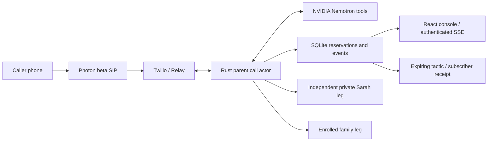

# FirstRing

**Latest sprint:** real Brev H100 Nemotron inference was demonstrated, but the full native tool continuation failed; it is not the live phone backend. The instance is deleted: **$2.60 spent, $57.40 credits remain**. General-purpose understanding, message/closing fixes and backend-aware console passed242Rust tests and41frontend unit tests; new live behavioral proof is still pending. [Current status](docs/progress.md), [Brev evidence](docs/brev-nemotron-deployment.md).

A Rust call-screening prototype for HackUTD 2026. A disclosed assistant screens unfamiliar callers, offers a private keypad choice, and withdraws that offer when the request changes. Rust owns permission and provider effects. The console shows actual actor events and separates real execution from authored replay.

**Verified live exchange, Nov 7 at 22:10 Central:** a real inbound Photon → Twilio Relay call completed a Nemotron tool/result conversation, protective refusal, minimized incident note and automatic hangup after the full goodbye. The caller confirmed hearing the responses. Eight in-call requests returned the exact specified NVIDIA model; HTTP latency was **1120–2892ms, median 1796ms**. The caller estimated **3–5 seconds** per reply; that is not instrumented audio latency. See the [live call receipt](docs/evidence/nvidia-relay-call-2026-11-07.json).

**Full Relay rehearsal remains pending:** deliberate interruption, obsolete-response rejection and reliable conversation in the noisy hackathon room still need live proof. The successful baseline was useful; a quiet environment is not an acceptance condition. Runtime is `live` / `relay`, caller A only, all three outbound flags false and 0 outbound actions/reservations. Phone B, private handoff and family phone gates remain unavailable/unverified. Caller-only model development passed 3/3; frozen held-out behavior finished 7/12, a failed gate. [Evaluation](docs/evaluation.md), [six inert voice-kit regressions](docs/voice-test-kit.md). The 36 generated development clips remain unlistened; interactive kit model evaluation is pending. Initial submission is due **23:00 Central**.

## Run the verified local replay

Prerequisites: Rust 1.99.1, Node 22.12+ and npm. This workspace has a project-local Rust toolchain under ignored `.tools/`; `scripts/cargo.sh` selects Cargo without changing your shell or global settings.

```sh
npm --prefix web ci
npm --prefix web run build
bash scripts/cargo.sh build --workspace
python3 scripts/run-replay.py
```

Open **http://127.0.0.1:8080**. Read the login token from `.tools/replay-admin-token` locally and enter it in the console. The helper creates a separate replay database, never edits `.env`, and disables external calling. Token storage is memory-only in the browser. Stop with Ctrl-C.

Run benign consent, revoked consent, and the benign new-number control from the console. After revocation, wait for Maya's applied receipt, select Maya for the next session, and run the risky replay again to inspect matched categorical memory. These authored events test the local workflow; they are **not** telephone or language-understanding evidence.

A 58-second labeled replay video and sanitized screenshot are saved in `.tools/artifacts/`. See the [recording instructions](web/README.md) to reproduce them and the [verification record](docs/verification.md) for actual test outcomes.

## Continue the caller-only voice gate

See [environment setup](docs/environment-setup.md). Preserve the existing `.env`, service and ledger. Keep `VOICE_TRANSPORT=relay`, `DEMO_EXECUTION_MODE=live`, `TEST_CALLS_AUTHORIZED=false`, `HANDOFF_CALLS_ENABLED=false` and `FAMILY_CALLS_ENABLED=false`. Earlier attempts failed at WebSocket startup, expired ingress and unfinished speech turns; their receipts remain recorded. The 22:10 exchange passed after ingress and turn-recovery work. Next is the current-room interruption check. Rachel-v4 is a preset, not a clone; Joanna supplies Say/Gather and the verified goodbye.

```sh
bash scripts/cargo.sh run --bin preflight
bash scripts/cargo.sh run --bin firstring
```

The purchased Photon line, authenticated Twilio SIP Domain and public HTTPS origin are configured. The inbound Voice URL is `/voice/incoming`, with status notifications to `/voice/status`. All voice endpoints validate the Twilio signature using the configured URL; there is no validation bypass. An authenticated operator requests Phone B with its contact ID after A calls manually. The durable global smoke budget allows one attempt, including uncertain outcomes. Reset does not clear that reservation.

Follow [provider preflight](docs/provider-preflight.md) and the [caller-only checklist](docs/demo-runbook.md) for contextual follow-up, changed request, interruption and message goodbye. Phone B delivery, private handoff/revocation and family calling remain deferred. Do not enable a later calling mode until its endpoint and external test scope exist.

The primary conversation transport is `VOICE_TRANSPORT=relay`; `gather` is the explicit turn-based fallback after a 30–45 minute Relay onboarding blocker. Gather pauses A while the private offer is pending, so it **does not demonstrate concurrent revocation**. Relay's optional undocumented speaker-event envelope still requires signed live capture; that subscription is disabled. Documented partial prompts and interruptions hold consent, while assistant diagnostics cannot cancel their own reply. No raw audio/SIP server is used.

## Checks

```sh
bash scripts/cargo.sh fmt --all -- --check
bash scripts/cargo.sh clippy --workspace --all-targets -- -D warnings
bash scripts/cargo.sh test --workspace
bash scripts/cargo.sh build --workspace
npm --prefix web run lint
npm --prefix web run typecheck
npm --prefix web test
npm --prefix web run build
npm --prefix web run test:browser
# With the local replay service running:
npm --prefix web run test:integration
```

Install the project-local test browser if needed: `cd web && PLAYWRIGHT_BROWSERS_PATH=0 npx --no-install playwright install chromium`. It is independent of skill installation.

`preflight -- --model-probe` performs a real, non-dialing native-tool probe when an NVIDIA key is configured; `--evaluate-held-out` uses the authored evaluation set. See [evaluation boundaries and results](docs/evaluation.md). No accuracy or phone-success percentage is inferred from state tests.

## Architecture and boundaries



Each session has a bounded actor mailbox. Generation and policy epochs reject stale model/audio/tool work; current evidence is required for assessment. Side effects are reserved before submission, status callbacks carry the reservation ID, terminal leg states do not regress, and ambiguous creates are never retried. A conference is shown connected only after the two intended joins. The caller never joins the independent family leg. Core screening ends at approved bridge commitment.

SQLite stores session aggregates (turns, assessments, offers, owned legs), a unique action ledger, event history, minimized tactics and subscriber versions. Replay/live tactic memory is isolated. Shared capsules contain categorical actions/context and expiry, not household names, numbers, quotes or transcripts. The two households are fictional, on one server.

There is no verified voice clone, text continuity, production carrier deployment or post-bridge monitoring. Native assistant TTS is a preset voice. See [capability/progress](docs/progress.md), [bootstrap audit](docs/bootstrap-audit.md), [event contract](docs/event-contract.md), and [submission draft](docs/submission.md).

Dependencies are pinned in Cargo/npm lockfiles. Project-local skills and upstream licenses/provenance are retained in `.agents/`. Existing repository `.idea` files were preserved.
