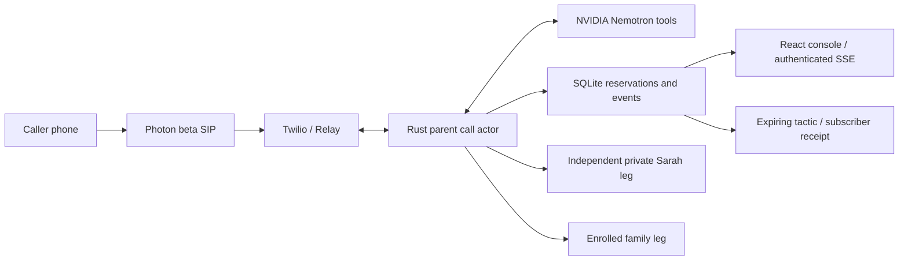

# FirstRing

A Rust call-screening prototype for HackUTD 2026. A disclosed assistant screens unfamiliar callers, offers a private keypad choice, and withdraws that offer when the request changes. Rust owns permission and provider effects. The console shows actual actor events and separates real execution from authored replay.

**Current checkpoint:** local transport, consent/revocation, model adapter, console and community logic are implemented. Phone audio, live Nemotron access and Relay onboarding remain **pending setup and live testing**. No real outbound call has been made. The only authorized external dial is one smoke-test attempt to locally configured Sarah / Phone B. Family calls remain disabled.

## Run the verified local replay

Prerequisites: Rust 1.99.1, Node 22.12+ and npm. This workspace has a project-local Rust toolchain under ignored `.tools/`; `scripts/cargo.sh` selects Cargo without changing your shell or global settings.

```sh
npm --prefix web ci
npm --prefix web run build
bash scripts/cargo.sh build --workspace
python3 scripts/run-replay.py
```

Open **http://127.0.0.1:8080**. Read the login token from `.tools/replay-admin-token` locally and enter it in the console. The helper creates a separate replay database, never edits `.env`, and disables external calling. Token storage is memory-only in the browser. Stop with Ctrl-C.

Run benign consent, revoked consent, and the benign new-number control from the console. After revocation, wait for Maya's applied receipt, select Maya for the next session, and run the risky replay again to inspect matched categorical memory. These authored events test the local workflow; they are **not** telephone or language-understanding evidence.

A 58-second labeled replay video and sanitized screenshot are saved in `.tools/artifacts/`. See the [recording instructions](web/README.md) to reproduce them and the [verification record](docs/verification.md) for actual test outcomes.

## Configure the real two-phone gate

See [where to obtain every environment value](docs/environment-setup.md). Copy `.env.example` to `.env` if it does not already exist. Configure secrets and designated numbers locally. Keep `HANDOFF_CALLS_ENABLED=false` and `FAMILY_CALLS_ENABLED=false`. For the single authorized smoke test set `VOICE_TRANSPORT=probe`, `DEMO_EXECUTION_MODE=live`, and `TEST_CALLS_AUTHORIZED=true` after checking the assigned Photon profile values.

```sh
bash scripts/cargo.sh run --bin preflight
bash scripts/cargo.sh run --bin firstring
```

Configure the Photon beta voice profile and authenticated Twilio SIP Domain to the public HTTPS origin. The inbound Voice URL is `/voice/incoming`; configure inbound status notifications to `/voice/status` where supported. All voice endpoints validate the Twilio signature using the configured URL; there is no validation bypass. An authenticated operator requests Phone B with its contact ID after A calls manually. The durable global smoke budget allows one attempt, including uncertain outcomes. Reset does not clear that reservation.

Follow [provider preflight](docs/provider-preflight.md) and the concrete [phone checklist](docs/demo-runbook.md). Provider account provisioning, tunnel/deployment, additional phone tests and family enrollment are not completed by this repository. Do not enable a later calling mode until its external test scope is authorized.

The primary conversation transport is `VOICE_TRANSPORT=relay`; `gather` is the explicit turn-based fallback after a 30–45 minute Relay onboarding blocker. Gather pauses A while the private offer is pending, so it **does not demonstrate concurrent revocation**. Relay's undocumented speaker-event envelope still requires signed live capture; unknown messages conservatively hold consent. No raw audio/SIP server is used.

## Checks

```sh
bash scripts/cargo.sh fmt --all -- --check
bash scripts/cargo.sh clippy --workspace --all-targets -- -D warnings
bash scripts/cargo.sh test --workspace
bash scripts/cargo.sh build --workspace
npm --prefix web run lint
npm --prefix web run typecheck
npm --prefix web test
npm --prefix web run build
npm --prefix web run test:browser
# With the local replay service running:
npm --prefix web run test:integration
```

Install the project-local test browser if needed: `cd web && PLAYWRIGHT_BROWSERS_PATH=0 npx --no-install playwright install chromium`. It is independent of skill installation.

`preflight -- --model-probe` performs a real, non-dialing native-tool probe when an NVIDIA key is configured; `--evaluate-held-out` uses the authored evaluation set. See [evaluation boundaries and results](docs/evaluation.md). No accuracy or phone-success percentage is inferred from state tests.

## Architecture and boundaries



Each session has a bounded actor mailbox. Generation and policy epochs reject stale model/audio/tool work; current evidence is required for assessment. Side effects are reserved before submission, status callbacks carry the reservation ID, terminal leg states do not regress, and ambiguous creates are never retried. A conference is shown connected only after the two intended joins. The caller never joins the independent family leg. Core screening ends at approved bridge commitment.

SQLite stores session aggregates (turns, assessments, offers, owned legs), a unique action ledger, event history, minimized tactics and subscriber versions. Replay/live tactic memory is isolated. Shared capsules contain categorical actions/context and expiry, not household names, numbers, quotes or transcripts. The two households are fictional, on one server.

There is no verified voice clone, text continuity, production carrier deployment or post-bridge monitoring. Native assistant TTS is a preset voice. See [capability/progress](docs/progress.md), [bootstrap audit](docs/bootstrap-audit.md), [event contract](docs/event-contract.md), and [submission draft](docs/submission.md).

Dependencies are pinned in Cargo/npm lockfiles. Project-local skills and upstream licenses/provenance are retained in `.agents/`. Existing repository `.idea` files were preserved.
